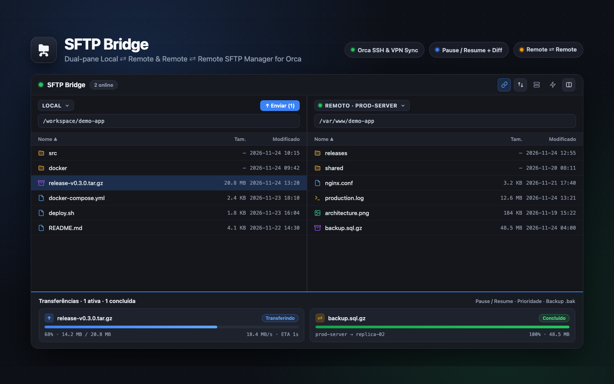

# SFTP Bridge — Plugin para Orca IDE

[Abrir na Orca (Catálogo da Comunidade)](https://orca.dev/plugins/hygorfragas.sftp-bridge?catalog=community) · [Repositório](https://github.com/hygorfragas/sftp-bridge) · Desenvolvido por **[Hygor Fragas](https://github.com/hygorfragas)**



Ponte SFTP integrada à sidebar da **Orca IDE** com suporte unificado para:
- **Hosts SSH** configurados na Orca (`orca host list`) e no `~/.ssh/config` (herdando `ProxyJump`, `IdentityFile`, `ssh-agent` e rotas de VPN)
- **Servidores Orca Remotos** (`ssh-tunnel` vinculados automaticamente + servidores pareados via IP de VPN com detecção inteligente e vínculo em 1 clique)
- **Conexões SSH manuais** (chave privada ou usuário/senha salvos no keyring criptografado do SO via `secrets:own`)

## Recursos

- **Local ⇄ Remoto e Remoto A ⇄ Remoto B (multi-sessão):**
  - Abre por padrão em **`Local × Remoto`**, mas ao passar o mouse no cabeçalho de qualquer painel (`LOCAL ⌄` ou `REMOTO ⌄`), você pode trocar a origem para qualquer outro servidor e transferir arquivos diretamente **entre dois servidores remotos** (SSH, Servidor Orca Remoto via VPN/Túnel ou manual, em qualquer direção).
  - Transferências **Remoto ⇄ Remoto** fazem streaming direto em memória (blocos de 64 KB) sem arquivos temporários no disco local, mantendo **pause/resume exato**, **Diff visual** e **backup `.bak`**.
- **Sincronização automática com a Orca + Gerenciador de Conexões:**
  - Hosts e Servidores Orca Remotos já conectados na Orca ficam automaticamente prontos (🟢) no SFTP Bridge, com sincronização em segundo plano (detecta novos hosts, reconexões e desconexões automaticamente).
  - Gerenciador dedicado de **Conexões e Hosts SFTP (`🖥️`)** e **Central Rápida (`⚡` / Status Bar)** com barra superior sempre fixa, status real ao vivo (🟢 conectado · 🟡 reconectando · 🔴 desconectado) e indicadores `Esq`/`Dir` dos hosts em uso.
- **Responsividade inteligente (Abas ↔ Menu ↔ Dividido):**
  - **Modo Dividido (`>= 520px`, estilo Electerm):** painéis lado a lado com divisor redimensionável, **Navegação Sincronizada (`🔗 Sync`)**, drag-and-drop entre painéis, **arrastar direto do Finder do macOS** para upload e botão/gaveta de transferências em destaque.
  - **Modo Abas (`< 520px` ou manual):** `Local` | `Remoto` | `Transferências` com badge/ponto vermelho dinâmico; abaixo de `310px` as abas viram um menu dropdown compacto.
- **Persistência completa de sessão:** lembra os endpoints dos dois painéis, pastas Local e Remota por host, layout, divisor e estado do `Sync` ao sair e voltar ao painel.
- **Segurança máxima contra sobrescrita:** detecção automática de conflitos em uploads, downloads e transferências remoto-a-remoto com **Diff visual linha a linha**, opção **Criar backup `.bak` antes de substituir**, **Renomear e manter ambos** ou **Pular conflitantes**.
- **Fila de Transferências completa:** pausar, iniciar/retomar do byte exato (`.orca-sftp.part`), parar/cancelar, prioridade (`Alta`, `Normal`, `Baixa`), reordenação (`Topo`, `Subir`, `Descer`), velocidade, ETA e item na Status Bar da Orca.
- **Busca recursiva em subpastas (`Subpastas`):** localiza arquivos em diretórios profundos tanto no Local quanto no Remoto (`find`) e abre direto no editor ou preview.
- **Visualizador de Logs ao Vivo (`tail -f`):** acompanhe logs remotos ou locais em streaming com filtro em tempo real, pausa de scroll e quebra de linha.
- **Editor rápido + Preview de Markdown e Imagens:** edite `.md`, `.txt`, `.srt`, `.json`, `.yml`, `.env` e código direto no painel (`⌘S` / `⌘F`), alterne **Editar ↔ Preview** em arquivos Markdown e visualize imagens (`.png`, `.jpg`, `.svg`, `.webp`, `.gif`) com zoom sem precisar baixar.
- **Menu de contexto (botão direito):** enviar/baixar (normal ou prioritário), editar, visualizar imagem, `tail -f`, compactar (`.zip` / `.tar.gz` no servidor ou local), descompactar (`.zip`, `.tar.gz`, `.tgz`, `.tar`, `.tar.bz2`, `.tar.xz`, `.gz`, `.7z`, `.rar`), nova pasta, novo arquivo, renomear, copiar caminho, `chmod` e excluir com confirmação.

## Desenvolvimento e Validação

```bash
npm install
npm run build
npm run typecheck
orca plugin test . --json
orca plugin validate ./plugin --json
orca plugin inspect ./plugin --json
```

## Licença

MIT — consulte [LICENSE](./LICENSE).
